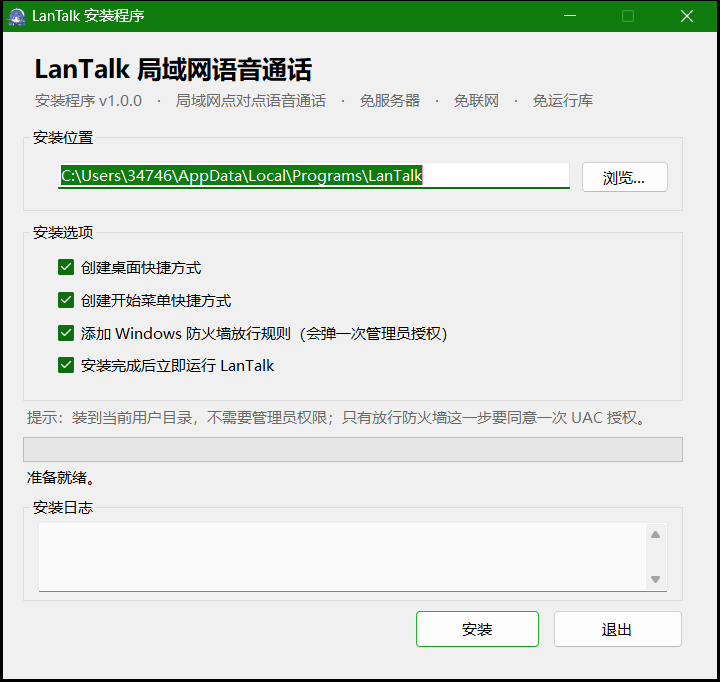
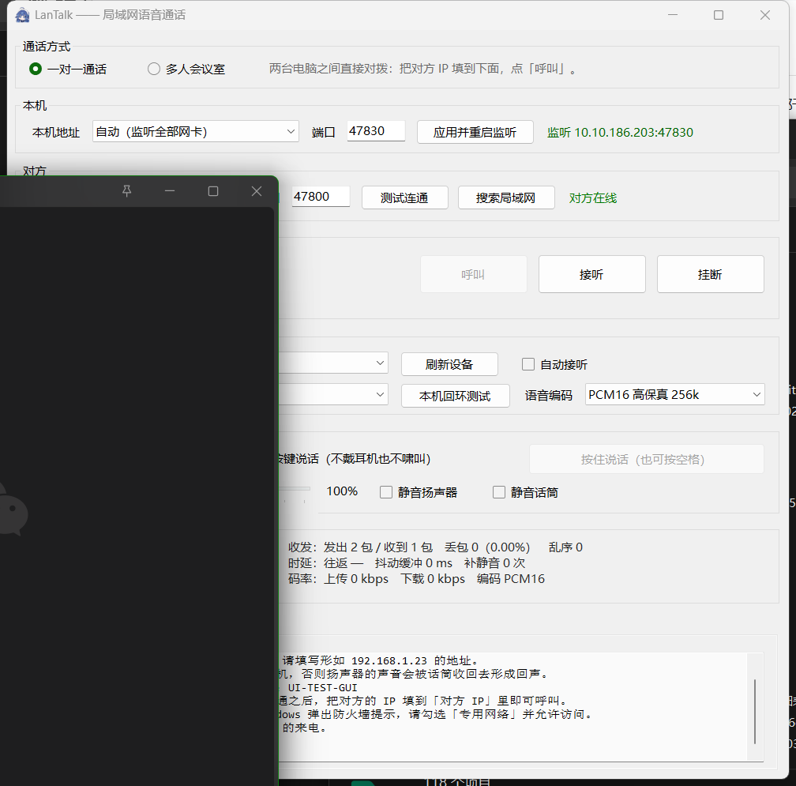
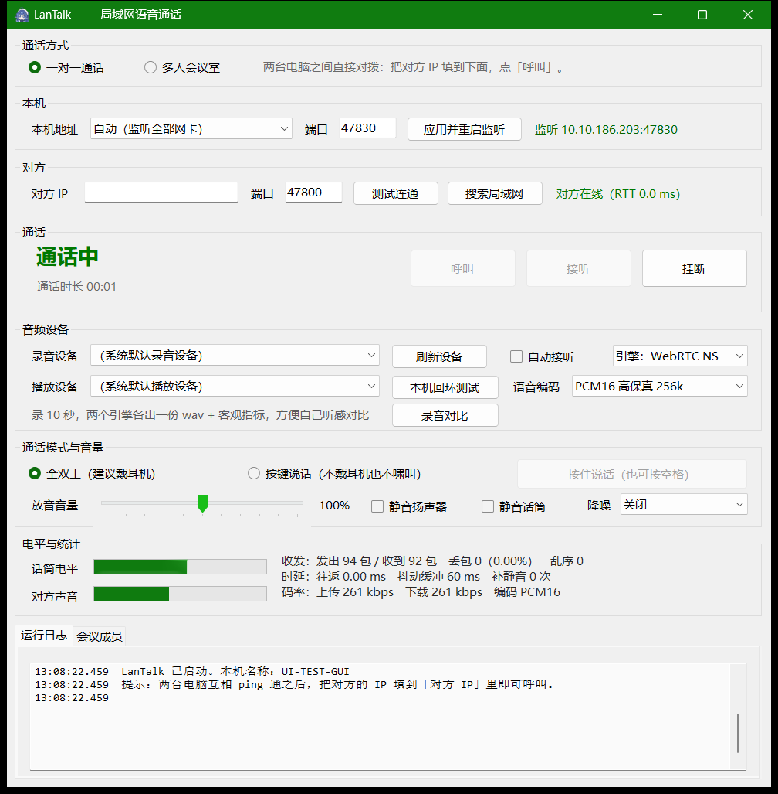
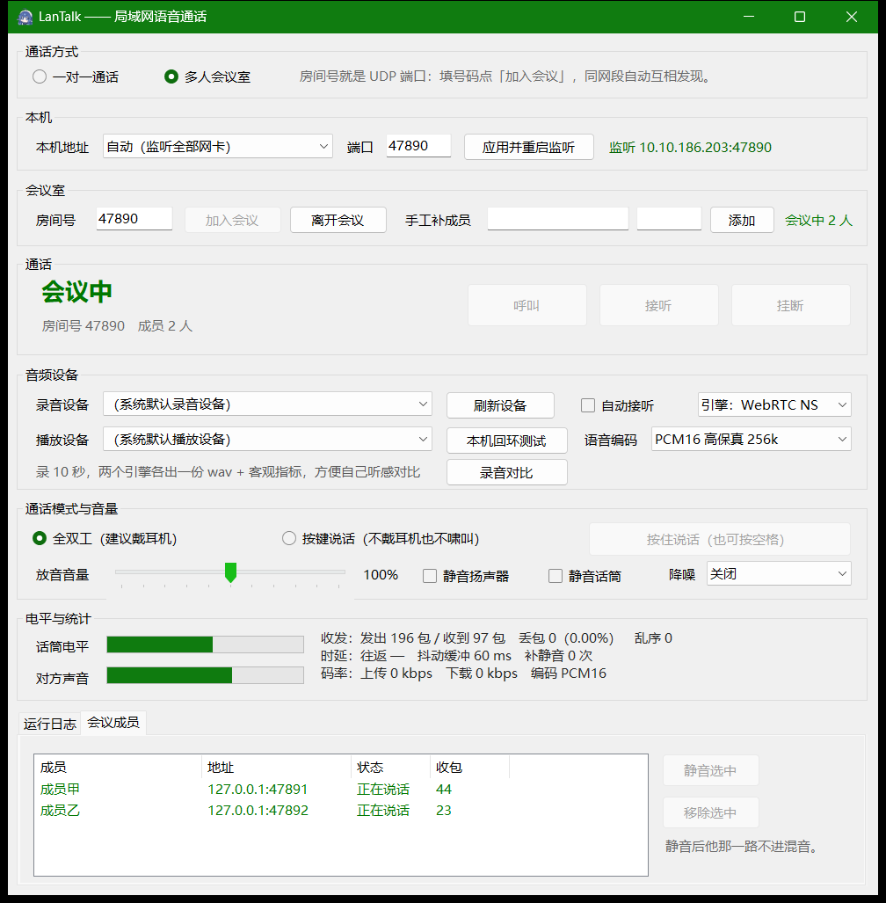

# LanTalk —— 局域网语音通话

**中文** | [English](README.en.md)

**两台电脑只要能互相 `ping` 通就能直接通话；3～8 个人还能开多人会议。**
不需要服务器、不需要联网、不需要安装任何运行库、不需要管理员权限。

**零第三方依赖**：纯 C# 5，用系统自带的 `csc.exe` 编到 .NET Framework 4.0。
不用 NuGet、不链接任何原生 DLL、不需要 Rust 或 C 工具链、不需要模型文件。

> 降噪做了**两版引擎**：一版是轻量的经典实现（高通 + 256 点 FFT + 最小统计噪声估计 +
> 维纳增益 + 重叠相加），另一版是 **WebRTC 降噪模块的完整 C# 移植**（经 Rust 重写版
> [sonora-ns]）。两版都保留、可在界面上随时切换。详见
> [§5.4](#54-语音降噪纯-c无第三方库) 与 [§5.5](#55-webrtc-降噪sonora-ns-的-c-移植)。

> **关于第三方内容**：本项目移植了 sonora-ns / WebRTC 的代码（BSD-3-Clause）。
> 哪些是移植的、哪些是原创的、附带了哪些上游源码，全部逐项列在
> **[THIRD-PARTY-NOTICES.md](THIRD-PARTY-NOTICES.md)** 里。

---

## 1. 为什么"ping 通就能用"基本成立

`ping` 通意味着**两台电脑的 IP 层互相可达**。只要 IP 层通，UDP 单播就能送达——同一网段可以，
跨网段有路由也可以。所以软件本身不需要任何中继服务器，直接点对点。

但有**一个前提必须说清楚**：

> `ping` 通 ≠ UDP 一定能进得来。**对方电脑的 Windows 防火墙必须放行本程序的入站 UDP。**

- 用安装包装的话，安装向导里勾选「添加 Windows 防火墙放行规则」就会自动放行（会弹一次管理员授权）；
- 直接把 exe 拷过去用的话，第一次运行 Windows 通常会弹「是否允许此应用通过防火墙」，
  勾选**专用网络**并允许即可；
- 都没弹、或者对方一直收不到呼叫，就运行一次 `Allow-Firewall.ps1`（需要管理员）；
- 软件里的 **「测试连通」** 按钮专门验证"UDP 到底通不通"——它发的是 UDP 探测包，不是 ICMP。

另外两种边界情况：

| 情况 | 结果 |
| --- | --- |
| 网络禁 ICMP（ping 不通）但放行 UDP | **仍然能用**，直接填 IP 呼叫即可 |
| ping 通但防火墙挡 UDP | **用不了**，必须先放行（或换端口后放行） |

---

## 2. 两种用法

### 方式一：用安装程序（推荐给不熟命令行的人）

双击 `dist\LanTalk-Setup-1.0.0.exe`：



- 默认装到当前用户目录（`%LOCALAPPDATA%\Programs\LanTalk`），**本身不需要管理员权限**；
- 会创建桌面和开始菜单快捷方式，并登记到「设置 → 应用」里，可随时正常卸载；
- 安装包**自带卸载程序**（装完后安装目录里的 `Uninstall.exe`），也能从「应用和程序」里卸载；
- 安装包是**单文件**的，本身内嵌了主程序，拷到别的电脑上直接就能装。

命令行静默安装 / 卸载：

```powershell
# 静默安装到指定目录，不放行防火墙、不自动启动
.\dist\LanTalk-Setup-1.0.0.exe --silent --dir "D:\Tools\LanTalk" --no-firewall --no-launch

# 静默卸载（用安装目录里的卸载程序）
& "$env:LOCALAPPDATA\Programs\LanTalk\Uninstall.exe" --silent
```

### 方式二：免安装单文件

直接把 `dist\LanTalk.exe` 拷到两台电脑上双击运行。整个程序就一个约 120 KB 的 exe，
不写注册表、不留残留，删掉文件就干净了。

### 从源码编译（离线）

```powershell
powershell -ExecutionPolicy Bypass -File build.ps1        # 产出 dist\LanTalk.exe
powershell -ExecutionPolicy Bypass -File build-setup.ps1  # 再产出安装程序
```

编译用的是 **Windows 自带的 C# 编译器**（`C:\Windows\Microsoft.NET\Framework64\v4.0.30319\csc.exe`），
**不需要联网、不需要装 Visual Studio、不需要 NuGet，也不需要 Inno Setup / NSIS 之类的打包工具**。

---

## 3. 一对一通话：三步

1. 在**对方**那台电脑上，记下界面上「本机」右侧显示的地址（形如 `192.168.1.23:47800`）。
   也可以点 **「搜索局域网」**，软件会自动发现同网段里正在运行的 LanTalk 并填好地址。
2. 在**本机**的「对方 IP」里填对方地址，端口默认 `47800`，点 **「呼叫」**。
3. 对方界面会显示 **「来电振铃中」** 并响铃，点 **「接听」** 即可通话。

> 🔊 **强烈建议戴耳机。** 不戴耳机时，扬声器放出来的对方声音会被自己的话筒收回去，形成回声甚至啸叫。
> 不想戴耳机就把模式切到 **「按键说话」**，按住按钮或**空格键**时才发送声音。

来电时：



通话中：



---

## 4. 多人会议（3～8 人）

切到「多人会议室」，填一个**房间号**，点「加入会议」就行。房间里的人会互相看见。



### 4.1 怎么组会

**房间号就是一个 UDP 端口**（默认 47800）。每台电脑在**自己的机器上**绑同一个端口号
（端口是按机器隔离的，不会冲突），再往各网段的广播地址的该端口发一个"我在这个房间"的公告。
同网段的人收到后就互相认识了。整个过程**没有服务器**。

收敛很快：新来的人广播一次，已经在房间里的人**同时**会单播回一个应答，
所以一个来回双方就都认出彼此了，不必等下一轮广播。

> ⚠️ 开会的人要**填同一个房间号**。改房间号就等于换了个房间，互相看不见。

### 4.2 广播被挡住怎么办（手工补 IP）

有些交换机、无线 AP 或企业网络会屏蔽广播。这时在「手工补成员」里填上对方的
`IP` 和端口，点「添加」即可。

- **只需要在一边添加**：你登记了对方之后，你的公告会让对方反过来认识你，双向就通了；
- 手工添加的条目只是"联系点"，对方真在房间里的话，几秒内会自动出现在成员列表里；
- 如果有好几台机器要互联，建议每台都加上其他人的地址，这样组成的是一张完整的网。

### 4.3 全网状直连 + 本地混音

每个人的语音**直接发给房间里的其他所有人**，收方把每一路各自过一个抖动缓冲，
再由混音器按样本叠加后放出来。

- 混音做了**限幅**：几个人同时大声说话也不会溢出成刺耳的爆音；
- 每一路的音量条独立显示，谁在说话一眼能看出来；
- 列表里可以**点名静音**：某人被他静音后，他那一路就不会混进他的扬声器（其他人不受影响）；
- 声音路由是按**发送者身份**（每个实例一个 4 字节 ID）而不是按 IP 来的——
  同一台电脑有多张网卡、或者走 VPN 有多条路径时，同一个人的声音也不会被当成两路叠加。

### 4.4 带宽

每人上行 = (人数 − 1) × 单路码率。

| 人数 | PCM16（约 260 kbps/路） | G.711 µ-law（约 130 kbps/路） |
| --- | --- | --- |
| 2 人 | 0.26 Mbps | 0.13 Mbps |
| 4 人 | 0.78 Mbps | 0.39 Mbps |
| 6 人 | 1.30 Mbps | 0.65 Mbps |
| 8 人 | 1.82 Mbps | 0.91 Mbps |

百兆局域网跑 8 人也绰绰有余。Wi-Fi 建议不超过 4～5 人，或者切到省流量的 µ-law。

### 4.5 常驻会议终端

带上 `--room` 启动就自动入会，适合把一台机器当会议室终端：

```powershell
.\dist\LanTalk.exe --room 47800
```

---

## 5. 工作原理

```
话筒 ──waveIn──▶ 20ms PCM 帧 ──编码──▶ UDP 包 ──┬──▶ 成员1
                (320 样本/640 字节)              ├──▶ 成员2   （全网状：每人一份）
                                                └──▶ 成员N
扬声器 ◀── 混音器 ◀── 每一路各自的抖动缓冲 ◀── 解码 ◀── 各成员的 UDP 包
```

### 5.1 传输：UDP 点对点，没有客户端/服务端之分

一对一：双方各绑一个端口（默认 `47800`），互相往对方 `IP:端口` 发包，谁都能主动呼叫谁。

会议：名单里有几个人就往几个人发，收到谁的就归到谁那一路。

报文格式：

| 类型 | 名称 | 载荷 |
| --- | --- | --- |
| `1` | 语音 | 4 字节序号 + **4 字节发送者ID** + 编码后的音频 |
| `2` / `3` / `4` | 呼叫 / 回铃 / 接听 | 编码方式 + 采样率 + 帧长 |
| `5` / `8` | 挂断 / 忙线 | 无 |
| `6` / `7` | 探测 / 应答 | 8 字节时间戳（算往返时延） |
| `9` / `10` | 发现广播 / 应答 | 端口 + 电脑名 |
| `11` | 说话状态 | 1 字节（按键说话用） |
| `12` / `13` / `14` | 会议室公告 / 应答 / 退出 | 房间号 + 实例ID + 名字 |

### 5.2 音频参数

| 项目 | 取值 |
| --- | --- |
| 采样率 / 声道 / 位宽 | 16000 Hz / 单声道 / 16 位 |
| 帧长 | 20 ms（320 个样本，640 字节） |
| 编码 | `PCM16`（原始，约 260 kbps）或 `G.711 µ-law`（压扩，约 130 kbps） |
| 设备接口 | `winmm.dll` 的 `waveIn` / `waveOut`（系统自带，无第三方依赖） |

### 5.3 抖动缓冲（听起来不卡的 key）

网络包会乱序、会抖动、偶尔会丢。每一路远端声音都不直接播，而是先过自己的抖动缓冲：

- **按序号有序排队**：先到 5 后到 4 也能排回 4→5；
- **先攒 60 ms 再开声**：避免开头断断续续；
- **丢包补静音**：中间缺帧就补静音，并计入"补静音次数"；
- **迟到帧丢弃**：序号比已播位置还小的直接扔；
- **堆太深就丢最旧的**：上限 400 ms，防止网络抖动把延迟越拖越大。

### 5.4 语音降噪（纯 C#，无第三方库）

采集到的声音在编码之前先过一级降噪，结构如下：

```
采集样本 ─▶ 高通(90Hz) ─▶ 加窗 ─▶ 256 点 FFT
                                     │
                  最小统计噪声估计 ◀──┤ 每个频点
                  判决引导先验信噪比 ◀┤
                  维纳增益+过减+谱底 ─┘
                                     │
输出样本 ◀─ 重叠相加 ◀─ 加窗 ◀─ 逆 FFT ◀─ 增益加权
```

- **16 kHz 原生**：256 点 FFT、128 点跳（50% 重叠），算法延迟 255 样本 ≈ **16 ms**；
- **噪声估计用最小统计**（0.5 秒窗口取每频点功率最小值 + 偏置补偿），不依赖语音活动检测，
  对风扇、空调、电流声这类稳态噪声跟踪很稳；
- **增益用维纳滤波**，配合过减系数与谱底，控制"音乐噪声"；
- **四档可调**：关闭 / 弱(-12dB 谱底) / 中(-18dB，推荐) / 强(-24dB)；
- 关闭时是**逐字节直通**（bit-exact），不引入任何延迟或改动。

实测（合成类语音 + 白噪声，分段信噪比）：

| 输入信噪比 | 处理后 | 改善 |
| --- | --- | --- |
| 0 dB | +2.3 dB | **+5.6 dB** |
| 6 dB | +4.4 dB | +1.8 dB |

高通部分单独验证：40 Hz 干扰压低 **-15.9 dB**，1 kHz 语音频段只衰减 -0.4 dB。

> 说明：这是"第一步"的轻量实现。第二步计划把 WebRTC 的降噪模块（sonora-ns，BSD-3，
> 同样是 16 kHz 原生）移植成 C# 替换它，以获得更好的非稳态噪声抑制（键盘、纸张等）。

### 5.5 WebRTC 降噪（sonora-ns 的 C# 移植）

除了上面那套轻量实现，还移植了 **WebRTC 的降噪模块**（经 sonora-ns 的 Rust 重写，
BSD-3-Clause），同样是纯 C#、零原生依赖，源码在 `src/Ns*.cs`：

| 文件 | 对应上游模块 |
| --- | --- |
| `NsFoundation.cs` | `config` / `fast_math` / `suppression_params` / `signal_model` / `prior_signal_model` / `histograms` |
| `NsFft.cs` | `ns_fft`（256 点实数 FFT、滤波器组窗、帧拼装、重叠相加、SNR） |
| `NsEstimators.cs` | `quantile_noise_estimator` / `wiener_filter` |
| `NsNoiseEstimator.cs` | `noise_estimator` |
| `NsSignalModel.cs` | `signal_model_estimator` / `prior_signal_model_estimator` |
| `NsSpeechProbability.cs` | `speech_probability_estimator` |
| `NsSuppressor.cs` | `noise_suppressor`（主流程）+ 对外接口 |

它和轻量版的思路完全不同：**用三个特征（对数似然比、谱平坦度、谱差）累积直方图，
每 500 帧反推一次先验模型**，再逐频点估出"这是语音的概率"，据此区分语音与噪声。
算法延迟只有 **96 样本 = 6 ms**（轻量版是 16 ms）。

两版引擎都保留、**在界面上随时切换**：「音频设备」组里的**降噪引擎**下拉（默认 WebRTC NS），
命令行等价开关是 `--denoise-engine ns|classic`。切换在通话中也生效（下一帧起）。

#### 移植中的数值口径（弄错就会和参考实现完全对不上）

1. **输入是 int16 量纲**（±32768）的浮点，不是归一化到 ±1；
2. **FFT 是未归一化的标准 DFT**。上游包的是 Ooura fft4g，这里直接实现等价的标准变换，
   反向用标准归一化逆变换保证互逆（上游的 `fft_ifft_roundtrip` 测试已原样移植验证）；
3. **分析窗是 `sin(πi/192)`**，只作用于 256 点扩展帧两端，中间 65 点不加权；
4. **`fast_log2f` 的位技巧必须逐位一致**（用 `[StructLayout(Explicit)]` 联合体等价实现 C++ 的 `*(uint32_t*)&in`）；
5. **`noise_estimator` 里的 `gamma` 是跨频点迭代延续的**——上游就这么写，移植时保持了同样行为。

#### 上游测试对齐情况

把 sonora-ns 的模块单测搬了过来，共 **32 项全部通过**：

| 自检项 | 内容 | 结果 |
| --- | --- | --- |
| `ns_core` | `fast_log2f` 与 C++ 位技巧逐值一致、FFT 往返/直流/冲激、窗表比对、直方图分箱 | 8/8 |
| `ns_estimators` | 维纳滤波器高/低信噪比行为、分位数估计收敛与跟踪、启动期缩放系数 | 6/6 |
| `ns_noise_est` | 初始状态、`LOG_TABLE`、`prepare_analysis` 拷贝、启动期参数化混合、语音/非语音概率下的更新方向 | 7/7 |
| `ns_sig_model` | 先验模型初值与权重归一、空直方图判噪声、平坦度特征启用、LRT 解析值、500 帧刷新 | 6/6 |
| `ns_speech_prob` | 初值、概率值域、高/低信噪比下的概率方向、先验概率钳位 | 5/5 |

#### 实测对比（合成类语音 + 白噪声，分段信噪比改善）

| 场景 | NS 中 | NS 强 | 轻量版 中 | 轻量版 强 |
| --- | --- | --- | --- | --- |
| 稳态白噪声 0 dB | +3.6 dB | +2.7 dB | **+4.5 dB** | +3.5 dB |
| 突发噪声（15ms 短促） | **-2.0 dB** | **-3.3 dB** | -2.3 dB | -4.8 dB |
| 纯语音、无噪声（直通量） | **-0.50 dB** | — | — | — |

（信号 40 秒，含词间真静音段、滑动共振峰、基频抖动。）

> **怎么读这张表**：两者在我的合成测试台上**基本旗鼓相当**，各有胜负——
> 稳态噪声下轻量版领先约 0.9 dB，突发噪声下 NS 在高档反超，而 NS 的算法延迟只有
> **6 ms（轻量版 16 ms）**。纯语音直通 -0.50 dB 说明 NS 在没有噪声时几乎是透明的，
> 不会去啃语音。
>
> **踩过的坑（值得记一笔）**：我最初的合成语音带着 0.18 的恒定底电平、**没有真正的静音段**，
> 结果 NS 的纯语音直通测出来是 **-4.70 dB**，看起来像移植有 bug。实际是分位数噪声估计
> 没有机会学到"底噪是多少"，只能把语音自身的平稳段当成噪声来抑制。把测试信号换成
> 真实语音结构（词间真静音 + 共振峰滑动 + 基频抖动）后降到 **-0.50 dB**。
> **教训：频域降噪的评测信号里必须有真正的静音段，否则测的是"降噪器能不能区分
> 平稳信号和噪声"——而这个问题本身就无解。**
>
> 突发噪声那一行两者都是负改善，因为 15 ms 的短促脉冲会被 FFT 在时间上抹开、
> 反而糊到语音上——这是频域降噪的共同局限，不是某一版的问题。

上面这张表说明两者差距很小，**谁也压不倒谁**，所以两版都留着、交给用户按自己的环境选：

| 引擎 | 相对强项 | 算法延迟 | 界面位置 |
| --- | --- | --- | --- |
| **WebRTC NS**（默认） | 用语音概率区分人声/噪声，对非平稳噪声更稳 | **6 ms** | 「音频设备」组 → 降噪引擎 |
| **轻量版** | 最小统计法在稳态噪声上略占优（本次实测 +0.9 dB） | 16 ms | 同上 |

两个引擎共用同一个「降噪」档位下拉（关闭/弱/中/强），切引擎不用重设档位。

真正拍板该选哪个，建议用下面的**录音对比**工具在**你自己的环境**里试一次——
合成信号测出来的差距只有 1 dB 左右，而你办公室的空调和键盘声才是真正的考题。

#### 自己动手验证：一键录音对比

合成信号测出来的差距只有 1 dB 左右，**真正拍板得靠你自己的耳朵和你的环境**。
所以内置了一个录音对比工具，点一下就出一份可对比的东西：

**界面**：「音频设备」组右上角的 **「录音对比」** 按钮 → 录 10 秒 → 自动处理 → 弹出指标摘要，
并询问是否打开输出文件夹。录音时请**正常说话、中间自然停顿几秒**——程序需要静音段来测底噪。

**命令行**（一样的东西，适合脚本化或远程）：

```
LanTalk.exe --record-ab 10                          # 录 10 秒麦克风
LanTalk.exe --record-ab-sim --record-ab 8           # 用合成语音，不占麦克风（验证用）
LanTalk.exe --record-ab 10 --record-ab-out D:\对比   # 指定输出目录
```

输出到 `我的文档\LanTalk降噪对比\时间戳\`：

| 文件 | 内容 |
| --- | --- |
| `1-原始录音.wav` | 原始录音，作为对照 |
| `2-降噪-WebRTC-NS.wav` | NS 引擎处理后 |
| `3-降噪-轻量版.wav` | 轻量版处理后 |
| `对比报告.txt` | 完整指标报告 |

**指标怎么读**（真实录音没有"干净参考"，所以不能用信噪比改善那套，这里换成三个不需要参考的量）：

| 指标 | 含义 | 期望 |
| --- | --- | --- |
| 噪声底 | 最安静的 10% 帧的平均功率 | 处理后**越负越好**（底噪被压下去了） |
| 语音电平 | 最响的 20% 帧的平均功率 | 处理后**掉得越少越好**（人声没被啃掉） |
| 估计信噪比 | 语音电平 − 噪声底 | 这个差**越大越好** |

改善 = 处理后的估计信噪比 − 原始的。报告会同时给出"噪声降了多少、语音掉了多少"，
**两者之差就是改善**——所以一眼就能看出这个引擎是在压噪声，还是连人声一起压了。
如果录音里语音和静音的差别不足 6 dB，报告会明确提示数据不可信、让你重录。

指标都是**按帧能量**算的，与算法的固定延迟无关，省掉了对齐这件事，
也就不会出现"因为没对齐所以指标全错"的假象。

> 三个量都只反映**能量**层面，听感还受"音乐噪声""语音发闷"等影响。
> 所以最靠谱的用法是：**先看指标排除明显有问题的，再用耳机挨个听一遍三个 wav。**

### 5.6 一对一的状态机

`空闲 → 呼出 → (对方接听) → 通话中 → 挂断 → 空闲`，并处理：

- 呼叫 35 秒无人接听 → 自动取消；来电 35 秒无人处理 → 自动挂断；
- 通话中对方 15 秒没有任何数据 → 判定断线并挂断；
- 一方正在通话时另一人来电 → 回「忙线」；
- 双方同时互相呼叫 → 自动接通（不会僵住）。

会议模式下没有振铃：加入即通话，成员进出由 10 秒无响应超时自动清理，
离开时会主动广播一条退出通知让对方立即摘掉自己。

---

## 6. 实测验证结果

所有验证都在本机完成（Windows 10.0.26200，64 位）。

### 6.1 单进程自检：18/18 通过

```
dist\LanTalk.exe --selftest
```

| 检查项 | 结果 |
| --- | --- |
| `device_enum` | 录音 2 项、播放 4 项，设备名正确 |
| `codec_mulaw_roundtrip` | 21846 个样本，最大误差 644（正好是 µ-law 理论值），平均 173 |
| `codec_mulaw_monotonic` | 解码值单调，查表无误 |
| `jitter_buffer` | 有序播放、乱序重排、迟到丢弃、丢包计数全部正确 |
| `mixer` | 三路相加结果正确、限幅到 32767、单路直通不串音、重复通道不重开 |
| `denoise` | 关闭时逐字节直通、FFT/重叠相加完美重构（误差 0 LSB）、0dB 输入改善 +5.6 dB、高通压 40Hz -15.9 dB 而 1kHz 只动 -0.4 dB |
| `ns_core` … `ns_speech_prob` | WebRTC 降噪移植的 32 项上游模块单测（见 5.5 节） |
| `ns_denoise_e2e` | NS 引擎端到端：稳态噪声 +3.6 dB、纯语音直通 -0.50 dB（透明），并与轻量版同台对比 |
| `denoise_compare` | 录音对比工具：wav 写读逐样本一致、指标判定正确、两个引擎都压低底噪、产出文件齐全 |
| `room_protocol` | 甲乙互相认出对方的名字、音频通道自动建立、一方退出另一方立即摘掉 |
| `udp_protocol` | 发 19 包收 19 包、逐字节一致、故意丢的 1 包被统计到、往返时延可测 |
| `codec_path_pattern` | 采集→编码→解码 24000 个样本逐样本一致 |
| `audio_devices_live` | 2 秒采集 101 帧（理论 100），话筒有信号 |
| `audio_loopback_live` | 真实声卡走完整链路：发 99 帧、播 96 帧、补静音 0 次 |
| `denoise` | 见上；另：`--denoise` 显式开启后通话仍正常建立（合成测试音会被改动，样本级校验自然失效属预期） |

### 6.2 双进程一对一真实通话

两个进程通过真实 UDP 互拨，**逐样本校验音频是否原样到达**：

| 编码 | 发出/解码帧数 | 丢包 | 乱序 | 端到端样本校验 |
| --- | --- | --- | --- | --- |
| PCM16 | 658 / 658 | 0 | 0 | **210560 / 210560 完全一致** |
| G.711 µ-law | 460 / 460 | 0 | 0 | **147200 / 147200 完全一致** |

### 6.3 三进程多人会议

三个进程组成一个房间，每个进程都要同时收两路、混音后播放：

| 实例 | 认出的成员 | 远端通道 | 丢包 | 端到端样本校验 |
| --- | --- | --- | --- | --- |
| 甲 | 乙、丙 | 2 | 0 | **273280 / 273280 完全一致** |
| 乙 | 甲、丙 | 2 | 0 | **278720 / 278720 完全一致** |
| 丙 | 甲、乙 | 2 | 0 | **273280 / 273280 完全一致** |

### 6.4 图形界面冒烟测试：13/13 通过

`tools\ui-smoke-test.ps1` 分两段，都是**真的把界面拉起来、真的走网络**：

```
=== 第一段：一对一通话 ===
[PASS] gui_launch            窗口已出现
[PASS] gui_incoming_call     界面出现「来电振铃中」
[PASS] gui_answer_button     找到「接听」按钮
[PASS] gui_answered          点「接听」后界面变成「通话中」
[PASS] gui_audio_end_to_end  端到端样本校验 337920/337920
[PASS] gui_call_established  主叫侧确认通话已建立
[PASS] gui_no_packet_loss    丢包 = 0
[PASS] gui_hangup            点「挂断」后界面回到「空闲」

=== 第二段：多人会议室（1 个界面 + 2 个无界面，全网状）===
[PASS] room_gui_joined       界面已进入会议状态
[PASS] room_two_members      界面显示「成员 2 人」
[PASS] room_member_audio     两个成员各 1785920/1785920 完全一致
[PASS] room_mesh_channels    每人的远端通道数 = 2
[PASS] room_no_packet_loss   丢包 = 0
```

### 6.5 安装程序

静默安装到临时目录 → 核对释放的文件（哈希与源一致）、桌面与开始菜单快捷方式、
「应用和程序」注册项 → 再用安装目录里的 `Uninstall.exe` 卸载 → 确认文件、快捷方式、
开始菜单文件夹、注册表项全部清理干净。

界面在 125% 缩放的屏幕上按 DPI 等比缩放，文字不会被截断。

---

## 7. 界面说明


| 区域 | 说明 |
| --- | --- |
| **通话方式** | 一对一通话 / 多人会议室，切换后下面两块配置区跟着换 |
| **本机** | 选监听哪块网卡（默认"自动"，监听全部），端口默认 47800 |
| **对方**（一对一） | 填对方 IP 和端口；「测试连通」发 UDP 探测包并显示往返时延；「搜索局域网」自动发现同伴 |
| **会议室** | 房间号 + 加入/离开；「手工补成员」填 IP 和端口；右侧显示当前人数 |
| **通话** | 大字状态；按钮按状态自动启用禁用 |
| **音频设备** | 选录音/播放设备；**降噪引擎**下拉（WebRTC NS / 轻量版）；「本机回环测试」把话筒声音绕一圈放回来，用来确认设备是否正常；「录音对比」录 10 秒并让两个引擎各出一份 wav + 客观指标 |
| **通话模式与音量** | 全双工（戴耳机）/ 按键说话（免耳机）；放音音量 0–200%；静音扬声器 / 静音话筒；**降噪档位**（关闭/弱/中/强） |
| **电平与统计** | 话筒电平和混音后的对方声音实时条；收发包数、丢包率、乱序数、往返时延、抖动缓冲深度、补静音次数、上下行码率 |
| **运行日志 / 会议成员** | 日志带时间戳并写入 exe 同目录的 `LanTalk.log`；成员页显示每人的地址、是否在说话、收包数，可点名静音或移除 |

---

## 8. 命令行参数

不带参数双击就是图形界面；带参数可以脚本化运行。

```
--local-port N     本机监听端口（默认 47800）
--bind IP          绑定到指定本机地址（默认 0.0.0.0 全部网卡）
--peer IP[:PORT]   一对一：对方地址
--peer-port N      一对一：对方端口（默认 47800）
--codec pcm|ulaw   语音编码（默认 pcm）
--denoise 档位     降噪：off|low|mid|high 或 关闭|弱|中|强（默认 mid）
--denoise-engine   降噪引擎：ns（默认，WebRTC NS 移植版）| classic（第一版轻量实现）
--record-ab 秒数   降噪对比：录 N 秒，两个引擎各出一份 wav + 客观指标（默认 10 秒）
--record-ab-sim    同上但用合成语音（不占麦克风，用于验证）
--record-ab-out    对比结果的输出目录
--name 名称        局域网发现/会议里显示的名字

--room N           多人会议：进入 N 号房间（房间号就是端口），启动即入会
--peers A:N,B:N    多人会议：手工补联系点，可只在一端添加

--selftest         运行自检（设备、编解码、抖动缓冲、混音器、会议协议、UDP、真实声卡）
--headless         不开界面
--auto-call        启动后自动呼叫 --peer
--auto-answer      自动接听来电
--duration N       无界面模式下运行 N 秒后退出
--null-audio       用内置测试音源/空放音替代真实声卡（自动化测试用）
--log PATH         日志文件路径
--help             显示帮助
```

例：把一台电脑当"自动接听的分机"：

```powershell
.\dist\LanTalk.exe --headless --local-port 47800 --auto-answer --duration 3600 --log D:\lantalk.log
```

例：三台机器开会（同一房间，各自监听 47800）：

```powershell
.\dist\LanTalk.exe --room 47800
```

---

## 9. 文件说明

```
离线语音项目\
├─ dist\
│   ├─ LanTalk.exe                  免安装单文件（约 120 KB）
│   └─ LanTalk-Setup-1.0.0.exe      安装程序单文件（约 190 KB，内嵌主程序）
├─ src\                             主程序源码（C# 5 / .NET Framework 4.0）
│   ├─ Mm.cs                        winmm 互操作、录音/放音设备封装
│   ├─ AudioPath.cs                 µ-law 编解码、抖动缓冲、多路混音器、采集↔网络↔播放
│   ├─ Net.cs                       UDP 收发、报文协议、多对端名单、丢包/时延统计、广播
│   ├─ Session.cs                   一对一通话状态机
│   ├─ Conference.cs                多人会议：房间发现、成员管理、音频路由
│   ├─ MainForm.cs                  图形界面（纯代码构建，含 DPI 缩放）
│   ├─ SelfTest.cs                  自检与无界面运行模式
│   ├─ Program.cs                   入口、命令行解析、日志
│   └─ AssemblyInfo.cs              程序集版本信息
├─ src\Setup\                       安装程序源码
│   ├─ InstallEngine.cs             释放文件、快捷方式、注册表、防火墙、卸载
│   ├─ SetupUi.cs                   安装向导与卸载界面
│   └─ SetupProgram.cs              安装程序入口、命令行、静默模式
├─ assets\                          图标、应用清单、说明里的截图
├─ tools\
│   ├─ make_icon.py                 生成图标（仅构建期用，需要 Python + Pillow）
│   └─ ui-smoke-test.ps1            界面冒烟测试（一对一 + 会议室 + 截图）
├─ build.ps1                        编译主程序
├─ build-setup.ps1                  编译安装程序（内嵌主程序）
├─ Allow-Firewall.ps1               防火墙放行脚本（需管理员，可选）
└─ README.md                        本文件
```

> 注意：两个 `.ps1` 必须保存为 **UTF-8 带 BOM**。Windows PowerShell 5.1 会把无 BOM 的
> UTF-8 当成 GBK 读，中文注释会导致语法错误。

---

## 10. 已知限制

1. **仅 Windows**（依赖 .NET Framework 4.x 与 winmm；Win7 及以上都自带）。
2. **仅 IPv4**。
3. **不做 NAT 穿透**：适用于能直接互访的局域网、企业内网、VPN（如 Radmin VPN、WireGuard）。
   真正跨公网、双方都在 NAT 后面时需要额外做打洞或中继，本软件没有做。
4. **语音不加密**：局域网内是明文 UDP。涉及敏感内容请自行在可信网络内使用。
5. **没有回声消除（AEC）**：不戴耳机时靠「按键说话」模式避免啸叫。做 AEC 需要相当复杂的算法，
   而按键说话在这个场景里已经够用，是个有意的取舍。
6. **会议是全网状的**：人数越多，每人的上下行带宽越大（8 人约 0.9～1.8 Mbps）。
   十几人以上就不适合了，那需要一台服务器做混音或转发。
7. **会议没有主持人/踢人**：任何人加入房间就能说话，只能在自己这边把别人静音。
   房间号是唯一的门槛。
8. **通话/会议中不能切换设备和编码**，改动会在下一次生效（避免掐断正在进行的通话）。
9. **采样率固定 16 kHz 单声道**。个别老声卡驱动不支持 16 kHz 会打不开设备，换一个设备再试即可。
10. **降噪是经典 DSP（第一版）**：对稳态噪声（风扇、空调、电流声）效果好，
    对键盘敲击、纸张翻动这类突发噪声抑制有限；这一版也不是深度学习方法。
11. **广播发现没能在单机验证**：同一台机器上多个实例不能绑同一个端口，
    所以"广播自动发现"这条路径只能靠两台真实机器验证；本机验证覆盖的是
    手工补 IP 的完整组网路径（同样的公告报文、同样的成员管理，只是投递方式从广播换成单播）。
12. **监听地址选成某块具体网卡时**，广播可能收不到（取决于网卡和网络），
    此时用"手工补成员"或改回"自动（监听全部网卡）"。

---

## 11. 常见问题排查

**对方无响应 / 一直"等待对方响应"**
1. 先点「测试连通」。如果显示"没有收到回应"，按顺序查：
   - 对方程序是否在运行？端口是否一致（默认都是 47800）？
   - 对方防火墙是否放行？→ 运行 `Allow-Firewall.ps1`，或让对方换端口后放行；
   - 两台电脑是不是真的在同一个能互访的网络里？`ping` 一下确认；
   - 本机有多块网卡（VMware、VPN 等）时，在「本机地址」里手动指定正确的那块网卡再试。

**会议里看不见别人**
- 确认大家填的是**同一个房间号**；
- 有些网络屏蔽广播，用「手工补成员」填对方的 IP 和端口（**只在一端添加也能双向组网**）；
- 看「运行日志」里有没有"成员加入"。

**能听见对方，但自己说话对方听不到**
- 看「话筒电平」条：说话时应该有明显起伏。没有就是选错了录音设备，在「音频设备」里换一个；
- 或者「静音话筒」被勾上了。

**听到自己的回声 / 啸叫**
- 戴耳机，或者切到「按键说话」模式。

**会议里某个人声音特别大/特别吵**
- 在「会议成员」里选中他，点「静音选中」。他那一路上就不会再混进来。

**声音断断续续**
- 看「丢包」和「补静音次数」：Wi-Fi 信号差就靠近路由器或改用网线；
- 可以切到 `G.711 µ-law`（省一半带宽），抗弱网稍好一些；
- 会议人多时优先用 µ-law。

**端口被占用**
- 换个端口（比如 47801）。一对一要两边都用同一个端口号；会议就是换房间号，所有人一致。

**卸载**
- 从「设置 → 应用」里卸载，或运行安装目录里的 `Uninstall.exe`。
  卸载会删掉程序文件、快捷方式、注册表登记和日志；防火墙规则需要管理员权限，
  拿不到权限时会跳过并提示（可用 `Allow-Firewall.ps1 -Remove` 手工清除）。

**想看更详细的过程**
- 界面「运行日志」区域，或 exe 同目录下的 `LanTalk.log`。

---

## 12. 第三方内容与许可

这一项单独列全，因为开源项目的署名不能含糊：**完整的清单在
[THIRD-PARTY-NOTICES.md](THIRD-PARTY-NOTICES.md)**，这里给个摘要。

| 内容 | 来源 | 许可 | 位置 |
| --- | --- | --- | --- |
| WebRTC 降噪模块，移植为 C# | [sonora-ns]（Rust）→ WebRTC `modules/audio_processing/ns/` | **BSD-3-Clause** | `src/Ns*.cs` |
| 上游单元测试，一并移植 | 同上 | **BSD-3-Clause** | 自检里的 `ns_*` 各项 |
| 上游 Rust 源码，原样附带 | [sonora-ns] | **BSD-3-Clause** | `third_party/sonora-ns/` |
| Ooura fft4g | — | — | **未复制任何代码**。`src/NsFft.cs` 是自己写的标准 DFT，只对齐了数值约定 |
| 最小统计噪声估计 | R. Martin, IEEE Trans. SAP, 2001 | 公开方法 | `src/Denoise.cs` |
| 判决引导先验信噪比 | Ephraim & Malah, IEEE Trans. ASSP, 1984 | 公开方法 | `src/Denoise.cs` |
| G.711 µ-law | ITU-T Recommendation G.711 | 公开标准 | `src/AudioPath.cs` |
| `winmm.dll` 接口 | Microsoft Windows SDK 文档 | — | `src/Mm.cs` |
| **应用图标源图** | **由仓库使用者提供** | **无法确认** | `assets/icon-source.png` |

⚠️ **图标是唯一一处我无法替你担保来源的素材。**`assets/icon-source.png` 是仓库使用者提供的图片，
不是我从网上下载的。如果它来自网络或他人作品，**公开发布前请确认你有权使用，或换成自己的图。**

其余部分均为原创：传输层、会话状态机、会议协议、抖动缓冲、混音器、两层界面、安装程序、
轻量版降噪引擎、录音对比工具、图标生成器、构建脚本与全部文档。

**许可**：本项目自身以 **MIT** 发布（见 [LICENSE](LICENSE)）。移植自 sonora-ns / WebRTC 的部分
**同时受 BSD-3-Clause 约束**——该许可证允许以其它条款再发布，但必须保留版权声明与免责声明，
这正是 `THIRD-PARTY-NOTICES.md` 与 `licenses/sonora-ns-LICENSE.txt` 的作用。
分发**二进制**（例如 Releases 里的安装包）时请一并附带 `THIRD-PARTY-NOTICES.md`，
以满足 BSD-3-Clause 对二进制再分发的署名要求。

[sonora-ns]: https://github.com/dignifiedquire/sonora
